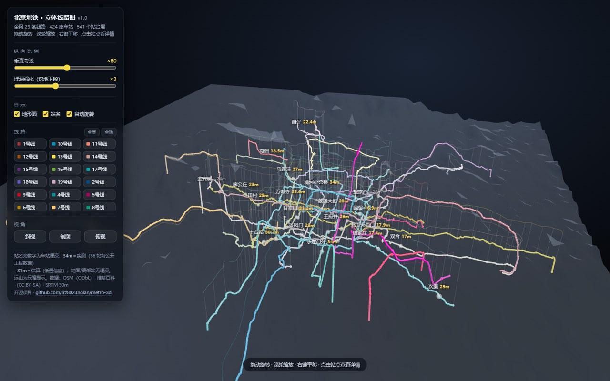
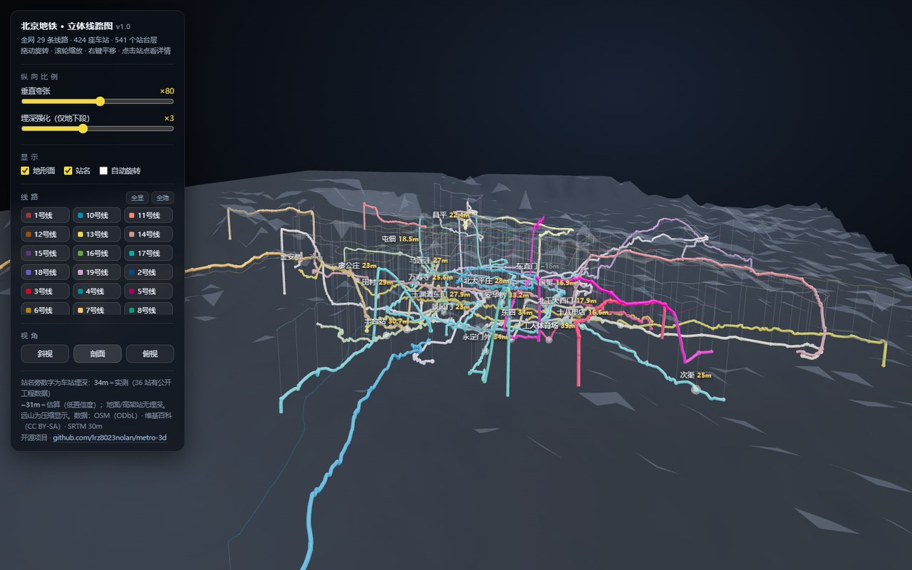
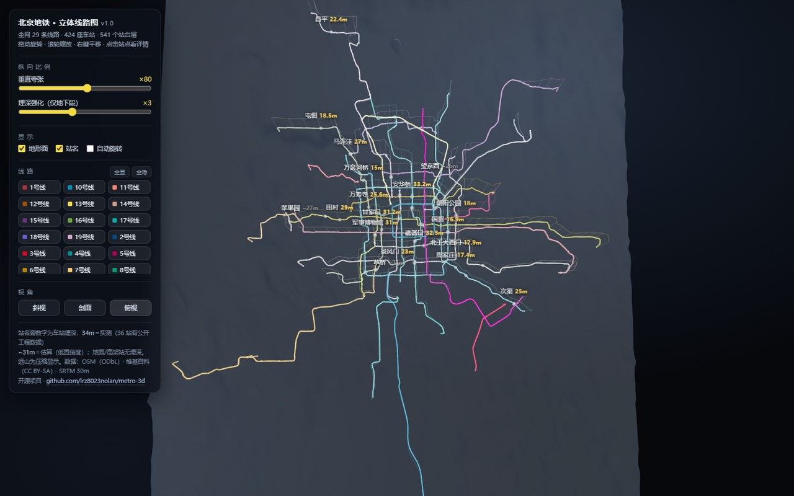
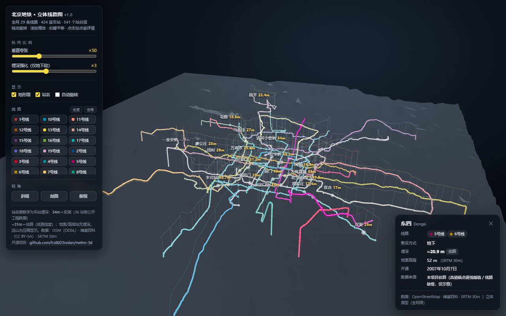

# metro-3d · 立体地铁线路图

[**English**](README.md) | **中文**

> 用公开数据制作的「垂直夸张」立体地铁线路图 —— 单文件 HTML，双击即开。
> 首个城市：**北京** —— 29 条线路 · 424 座车站 · 541 个站台层。



## 这是什么

一个交互式三维地图，把地铁线网按照它在地下的真实姿态画出来：每条线画在
地表以下的实际深度，并叠上地形作为参考。思路借鉴莫斯科人康斯坦丁·多布罗夫
的莫斯科地铁 3D 深度图（更早还有叶夫根尼·瓦尔福洛梅耶夫 2013 年的原版，
方法公开可查）——本项目把它移植到北京，并做成可适配任意城市的通用结构。

- **单文件、完全离线** —— `dist/beijing.html`（约 1 MB）双击即开；
  three.js、数据和应用代码全部内联，无需网络、无需密钥。
- **真实数据、诚实标注** —— 几何与车站来自 OpenStreetMap，地面高程来自
  SRTM，车站埋深从维基百科与公开报道逐条整理。每条实测埋深都带口径、来源和
  置信度；插值补齐的埋深一律标注 `~`，信息卡里写明"估算"。
- **交互**：拖动旋转 / 滚轮缩放 / 右键平移 · 垂直夸张滑块 · 埋深强化滑块 ·
  29 个线路开关 · 站点信息卡 · 三个视角预设（斜视 / 剖面 / 俯视）·
  自动旋转 · 站名防重叠。

| 剖面视角 | 垂直夸张 ×80 | 站点信息卡 |
|---|---|---|
|  |  |  |

## 试一试

- **下载即用**：打开 [`dist/beijing.html`](dist/beijing.html)，双击即可。
- **GitHub Pages**：本仓库开启 Pages 后（分支 `main`、目录 `/`），
  访问 `https://lrz8023nolan.github.io/metro-3d/` 即可在线查看。

## 从源码构建

环境要求：Python 3.10+（仅标准库）。

```bash
python scripts/build.py --city beijing
# → build/beijing_data.js   （中间产物：运行时数据）
# → dist/beijing.html       （单文件查看器）
```

校验与渲染自检：

```bash
python tests/validate_data.py                     # 数据集 schema 与引用完整性校验
npm install && node tests/verify_render.js        # 无头浏览器渲染验证（复用系统 Edge/Chrome）
```

## 仓库结构

```
viewer/    渲染层（与城市无关）：app.js、template.html、内联用 three.js r149
cities/    数据层，一城一包：
           city.json · build_config.json · terrain_grid.csv · wiki_line_stations.csv · manual/
scripts/   build.py / build_data.py / build_html.py
           collect/   北京数据采集管线（原样保留，用于追溯数据出处）
dist/      构建产物（随仓库提交）：dist/beijing.html
docs/      数据 schema、数据来源、图片
tests/     数据校验 + 无头渲染验证
```

## 数据模型（简版）

每个城市数据包由两份输入驱动：

- **`city.json`** —— 规范数据集：`lines[]`（线色、几何、站序）与
  `stations[]`（坐标、高程、敷设方式、开通日期、埋深＋口径＋来源＋置信度）。
  完整字段定义见 [docs/schema.zh-CN.md](docs/schema.zh-CN.md)。
- **`build_config.json`** —— 埋深模型的构建参数：真值映射、估算锚点、
  线路缺省值、地面/高架偏移量。

构建流程：推导线剖面（`轨面 = 地面 + 带符号偏移`）→ 沿弧长插值 → 站点吸附
到折线 → 全部内联进单个 HTML。

## 数据来源与许可

| 数据 | 来源 | 许可 |
|---|---|---|
| 线路几何、车站、站序 | OpenStreetMap（Overpass API） | ODbL 1.0 |
| 车站属性与埋深证据 | 中文维基百科 | CC BY-SA 4.0 |
| 地面高程 / 地形网格 | SRTM 30 m（经 OpenTopoData） | 公有领域 |
| 具体车站埋深 | 新闻与工程报道（逐条注来源） | — |

逐条引用、置信度框架与已知注意点见
[docs/data-sources.zh-CN.md](docs/data-sources.zh-CN.md)；
北京数据集的完整构建记录见
[docs/data-inventory.zh-CN.md](docs/data-inventory.zh-CN.md)。

**许可**：代码（查看器与脚本）为 MIT —— 见 [LICENSE](LICENSE)；
数据集沿用上表各自的上游许可，复用时请保留署名。

## 路线图

- [ ] 起点-终点路径检索与高亮
- [ ] 时间轴（看线网逐年生长）
- [ ] 可选的合规底图（通过自定义三维图层接入）
- [ ] 更多城市 —— 渲染层与城市无关，加一座城市 = 加一个数据包

欢迎参与贡献 —— 见 [CONTRIBUTING.zh-CN.md](CONTRIBUTING.zh-CN.md)。

## 致谢

- 概念来源：康斯坦丁·多布罗夫的莫斯科地铁 3D 深度图；叶夫根尼·瓦尔福洛梅耶夫
  2013 年原版。
- 使用 [three.js](https://threejs.org/) r149（MIT）构建。
- 数据：© OpenStreetMap 贡献者（ODbL）· 中文维基百科（CC BY-SA）·
  NASA/USGS SRTM。
